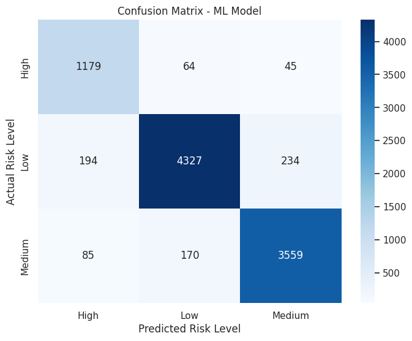

# Contract-Risk-AI

**Contract-clause risk classification.** An NLP pipeline that classifies contract clauses from the LEDGAR corpus into **High, Medium and Low** risk groups, comparing a classical model (TF-IDF + Logistic Regression) with a deep-learning model (LSTM).

> **Important:** the High/Medium/Low groups are an **experimental mapping** of LEDGAR provision labels that I defined for this project. They are **not legally validated risk assessments**, and this project is not legal advice.

An individual academic project.

**Stack:** Python · pandas · NLTK · scikit-learn · TensorFlow/Keras · Hugging Face `datasets` · Matplotlib/Seaborn · Google Colab

## Project at a glance

| | |
|---|---|
| Task | 3-class text classification of contract clauses |
| Data | LEDGAR via Hugging Face `coastalchp/ledgar` (train split, 60,000 clauses) |
| Models | TF-IDF + Logistic Regression · Embedding + LSTM |
| Notebook | [`Contract-Risk-AI.ipynb`](Contract-Risk-AI.ipynb) |

## Dataset

[LEDGAR](https://huggingface.co/datasets/coastalchp/ledgar) is a corpus of labelled contract provisions. The notebook downloads it from the Hugging Face Hub (public, no token required) and uses only the **train split**.

- A hand-written dictionary maps **72 LEDGAR label IDs** to a risk group (13 High, 27 Medium, 32 Low). Clauses with any other label are dropped.
- Result: **49,282 clauses**: Low 23,771 · Medium 19,071 · High 6,440.
- The notebook does not include contracts or any other data of its own. Check the dataset page for its license and terms.


## Methodology

1. **Preprocessing:** lowercase, remove digits and punctuation, remove English stop words, WordNet lemmatization.
2. **Model 1: TF-IDF + Logistic Regression.** `TfidfVectorizer(max_features=5000)` fitted on the training set; `LogisticRegression(class_weight='balanced', max_iter=1000)`. Stratified 80/20 split (`random_state=42`): 39,425 training / 9,857 test clauses.
3. **Model 2: LSTM.** Keras `Tokenizer` (20,000 words, sequences padded to 200) → Embedding(128) → LSTM(128, dropout 0.3, recurrent dropout 0.3) → Dense(64, ReLU) → Dropout(0.5) → Dense(3, softmax). Adam, sparse categorical cross-entropy, 5 epochs, batch size 64, `validation_split=0.1`. Same split parameters and class supports as Model 1.
4. **Evaluation:** classification report and confusion matrix on the held-out 9,857 clauses.

## Results reported by the notebook

Saved outputs from the original Colab run; they were not re-run for this repository.

| Model | Accuracy | Macro F1 | High-risk precision / recall |
|---|---|---|---|
| TF-IDF + Logistic Regression | 0.92 | 0.91 | 0.81 / 0.92 |
| LSTM | 0.9258 | 0.91 | 0.89 / 0.84 |

<p>
  
  
</p>

Each model was run once on a single split, so the small accuracy difference should not be over-interpreted. The notebook's final comparison printout uses a hard-coded 0.92 for Logistic Regression rather than the computed value.

## Limitations

- **Labels are experimental.** Scores measure how well the models reproduce the hand-made mapping from LEDGAR labels to risk groups, not real legal risk.
- Single train/test split and a single run per model; no cross-validation. Duplicate or near-duplicate clauses were not checked for across the split, and the LSTM tokenizer vocabulary is fitted on the full cleaned corpus before splitting.

## Setup

1. Open the notebook in Google Colab, or locally with Python 3.10+:
   ```bash
   pip install -r requirements.txt
   jupyter lab   # or: jupyter notebook
   ```
2. Run the cells in order. NLTK downloads `stopwords` and `wordnet` automatically; the dataset downloads from Hugging Face. The LSTM section takes several minutes on Colab (about 4 minutes per epoch in the saved log).
3. The first cell runs `!pip install datasets pandas matplotlib`; the remaining packages are in `requirements.txt`.

The notebook writes a generated `final_preprocessed_data.csv`, which is ignored by Git. It has not been tested outside Google Colab.

## Repository structure

```
Contract-Risk-AI/
├── Contract-Risk-AI.ipynb   # notebook with original code and saved outputs
├── assets/                  # figures extracted from the notebook outputs
├── requirements.txt
└── README.md
```

The notebook code is unchanged apart from tidying comments (removing course-related notes and stray citation markers) and removing one closing print line; markdown documentation cells were added. Some remaining code comments are in Arabic.
