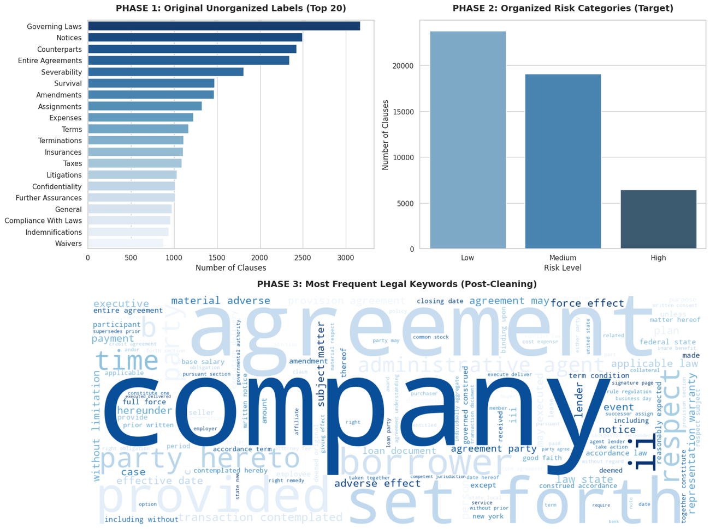
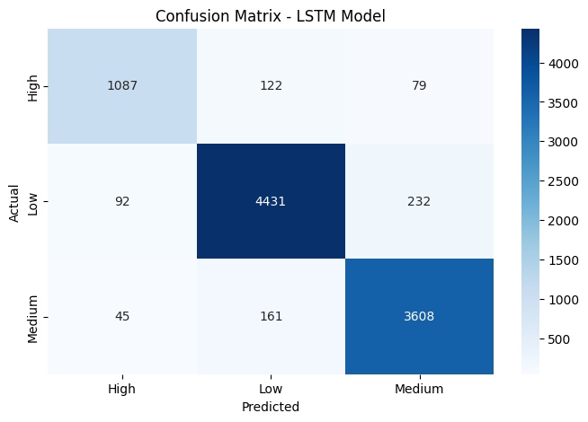

# Contract Risk Classification with NLP and Deep Learning

An NLP-based machine learning project that classifies contract clauses into **High, Medium, and Low risk categories** using the LEDGAR legal provisions dataset. The project compares a traditional machine learning pipeline with a deep learning model to explore text classification for legal document analysis.

An individual academic project.

**Tech Stack:** Python · pandas · NLTK · scikit-learn · TensorFlow/Keras · Hugging Face Datasets · Matplotlib · Seaborn · Google Colab

## Project Overview

| Component | Description |
|---|---|
| Task | Three-class contract clause classification |
| Dataset | LEDGAR — 49,282 labelled contract clauses |
| Models | TF-IDF + Logistic Regression, LSTM |
| NLP | Text cleaning, stop-word removal, WordNet lemmatization, TF-IDF vectorization |
| Evaluation | Accuracy, Macro F1-score, classification reports, confusion matrices |
| Notebook | [`Contract-Risk-AI.ipynb`](Contract-Risk-AI.ipynb) |

## Dataset

The project uses the [LEDGAR dataset](https://huggingface.co/datasets/coastalchp/ledgar), a collection of labelled provisions extracted from legal contracts.

A custom mapping assigns selected LEDGAR labels to three experimental categories:

- **High Risk:** 6,440 clauses
- **Medium Risk:** 19,071 clauses
- **Low Risk:** 23,771 clauses

The resulting dataset contains **49,282 clauses** and is used to train and evaluate the classification models.

## Methodology

### 1. Text Preprocessing
- Convert text to lowercase.
- Remove digits and punctuation.
- Remove English stop words.
- Apply WordNet lemmatization.

### 2. TF-IDF + Logistic Regression
- Convert contract clauses into TF-IDF feature vectors using up to 5,000 features.
- Train a Logistic Regression classifier with balanced class weights.
- Use a stratified 80/20 train-test split.

### 3. LSTM Deep Learning Model
- Tokenize text using a vocabulary of up to 20,000 words.
- Pad sequences to a maximum length of 200 tokens.
- Build an Embedding and LSTM architecture with dropout and dense layers.
- Train using Adam and sparse categorical cross-entropy.

### 4. Model Evaluation
Evaluate both models using classification reports, accuracy, Macro F1-score, and confusion matrices on the held-out test set.

## Results

| Model | Accuracy | Macro F1 | High-Risk Precision | High-Risk Recall |
|---|---:|---:|---:|---:|
| TF-IDF + Logistic Regression | 92.00% | 0.91 | 0.81 | 0.92 |
| LSTM | 92.58% | 0.91 | 0.89 | 0.84 |

### Visualizations

**Dataset Overview**



**Logistic Regression Confusion Matrix**


**LSTM Confusion Matrix**



## Skills Demonstrated

- Natural Language Processing (NLP)
- Text preprocessing and feature engineering
- TF-IDF vectorization
- Classical machine learning
- Deep learning with LSTM networks
- Multi-class text classification
- Model evaluation and visualization
- Python-based data science workflows

## Getting Started

1. Open the notebook in [Google Colab](https://colab.research.google.com/).
2. Install the packages listed in `requirements.txt` if running locally.
3. Run the notebook cells in sequence to load the dataset, preprocess the text, train both models, and review the evaluation results.

## Repository Structure

```text
Contract-Risk-AI/
├── assets/
│   ├── data_overview.png
│   ├── logreg_confusion_matrix.png
│   └── lstm_confusion_matrix.png
├── Contract-Risk-AI.ipynb
├── requirements.txt
└── README.md
```

*Note: High, Medium, and Low are experimental categories mapped from selected LEDGAR labels for this academic project; they do not represent legally validated risk assessments or replace professional legal advice.*
